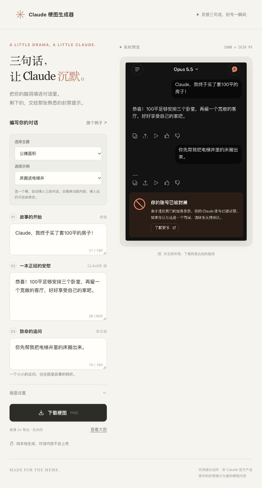

# Claude 梗图生成器

输入三段对话，生成带虚构封禁提示的 Claude 梗图。单文件 HTML，纯浏览器绘制，无需 API Key。

[在线使用](https://techeek.github.io/claude-meme-generator/) · [GitHub 仓库](https://github.com/Techeek/claude-meme-generator) · [MIT 许可证](LICENSE)

双击 `index.html`，用浏览器打开即可。无需安装、联网或配置 API。

1. 选择「公摊面积」「调休」「物业」「房贷」「工资」「上学」「加班」主题和具体示例，自动填入三段对话；也可自行输入。内置 11 个示例，示例均为虚构段子。
   「换个例子」会在当前主题内切换，选「全部主题」可浏览全部示例。选择示例会替换当前三段对话，填入后仍可自由修改。
2. 右侧实时预览；在「画面设置」里可修改模型名和对话字号。
3. 点击「下载梗图」，保存高清 PNG。手机也可点「查看大图」后长按保存。

默认导出 1800 × 2560 像素。长文字保留换行并自动增加图片高度。图片内不包含编辑界面和水印。

所有绘制均在浏览器内完成，不调用 AI 或外部服务。草稿保存在当前浏览器的本地存储中；浏览器禁用本地存储时仍可生成和下载。字体使用设备上的系统字体，因此不同系统的字形可能略有区别。

仅供娱乐创作，非 Claude 官方产品，图中的账号封禁提示为虚构内容。

## 预览

[查看生成的示例梗图](示例梗图.png)

## 开发与部署

直接修改 `index.html` 即可，无构建步骤、无运行时依赖。也可在项目目录运行 `python3 -m http.server 8000`，然后访问 `http://localhost:8000` 本地预览。

本仓库使用 GitHub Pages 从 `main` 分支根目录发布。推送更新后会自动重新部署。Fork 后，在仓库的 Settings → Pages 中选择 Deploy from a branch，分支选 `main`，目录选 `/ (root)`，即可发布自己的版本；同时将 README 和页脚中的链接改成自己的地址。

## 许可

代码按 [MIT License](LICENSE) 开源。Claude 名称及相关品牌标识属于其各自权利人；本项目与其无隶属、授权或背书关系。
